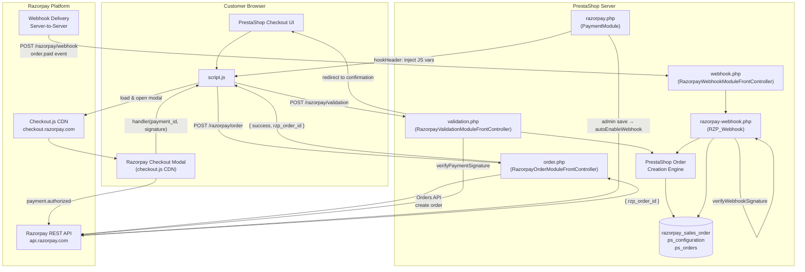

# HLD: System Overview — Razorpay PrestaShop

## Component Responsibilities

| Component | Layer | Responsibility |
|---|---|---|
| `razorpay.php` | Module | Config, hooks, webhook setup |
| `order.php` | Controller | Razorpay Order creation, JSON API |
| `validation.php` | Controller | Signature verify, PS order creation |
| `webhook.php` | Controller | Webhook entry point |
| `razorpay-webhook.php` | Service | Webhook business logic, race condition handling |
| `script.js` | Frontend | Modal orchestration, button management |
| `razorpay-sdk/` | Library | HTTP client for Razorpay API |
| `razorpay_sales_order` | Database | Payment state tracking, duplicate prevention |
